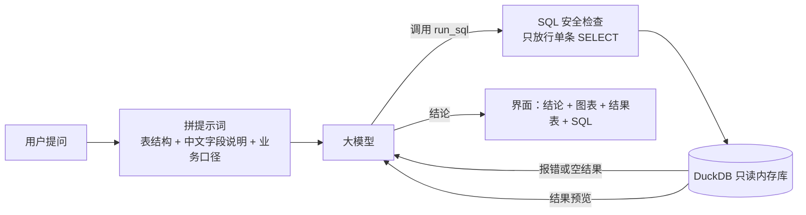

# 智能问数助手

用中文问数据，它自己写 SQL、查数据库、画图，并用一两句话给出结论。查询出错时，它会读报错、自己改 SQL 再试。

> 在线体验：部署后补上链接
> 演示动图：部署后补上

例如问“各州的平均配送天数是多少？哪个州最慢？”，它会：

1. 根据表结构写出 SQL，关联订单、用户、州三张表；
2. 在只读数据库里执行；如果字段写错了，把报错发回给模型，模型改完再执行；
3. 自动选图（这里是横向柱状图），并写出结论：“配送最慢的是罗赖马州，平均 29.3 天……”。

## 功能

- **中文提问，自动出 SQL**：基于大模型的工具调用（function calling），模型调用 `run_sql` 执行查询。
- **报错自动修正**：SQL 报错或结果为空时，把信息反馈给模型修正，最多重试 2 次；界面的“执行过程”里能看到每一次尝试。
- **自动选图**：按结果的形状选择折线图、柱状图、饼图或指标卡。
- **多轮追问**：可以接着问“那按年份拆开呢？”，模型能看到前几轮的问题和 SQL。
- **上传自己的数据**：支持 CSV 和 Excel，自动生成表结构说明。
- **可切换模型**：DeepSeek Flash、DeepSeek V4 Pro、智谱 GLM-4-Flash（免费）。

## 架构



**只读与安全**：公开演示里任何人都能输入问题，所以 SQL 有三层保护：

1. 用 DuckDB 自带的解析器检查，只允许一条 `SELECT`，并拦截读写文件的函数；
2. 数据库建好后关闭文件访问、锁定配置，即使绕过第一层也读不了服务器上的文件；
3. 每条查询 10 秒超时、最多返回 1000 行。

## 本地运行

需要 Python 3.10 以上，以及 DeepSeek 或智谱任意一家的 API key。

```bash
git clone https://github.com/timmyknew/timmyknewhere.git
cd timmyknewhere
python -m venv .venv
source .venv/bin/activate        # Windows: .venv\Scripts\activate
pip install -r requirements.txt
cp .env.example .env             # Windows: copy .env.example .env
# 打开 .env，填上 DEEPSEEK_API_KEY 或 ZHIPUAI_API_KEY
streamlit run app.py
```

浏览器会自动打开 http://localhost:8501 。

运行测试（不需要 API key，用的是脚本化的假模型）：

```bash
pytest
```

## 项目结构

```
app.py                  Streamlit 界面
askdata/
  agent.py              问数 Agent：生成 SQL → 执行 → 反馈修正 → 写结论
  llm.py                大模型调用（OpenAI 兼容接口）
  config.py             可选模型
  db.py                 只读 DuckDB、查询超时、表结构说明
  sql_guard.py          SQL 安全检查
  charts.py             自动选图
  datasets.py           内置数据的中文字段说明和业务口径
data/olist/             处理好的电商数据（parquet）
scripts/build_olist.py  下载并清洗原始数据
tests/                  单元测试
```

## 评测（进行中）

计划用约 100 道带标准答案的问题，按查询结果自动判对错，对比不同模型、有无字段说明、有无自动纠错时的准确率。

## 数据

内置数据是 [Olist 巴西电商公开数据集](https://www.kaggle.com/datasets/olistbr/brazilian-ecommerce)（2016–2018，约 10 万订单，CC BY-NC-SA 4.0），处理方式见 [data/README.md](data/README.md)。
