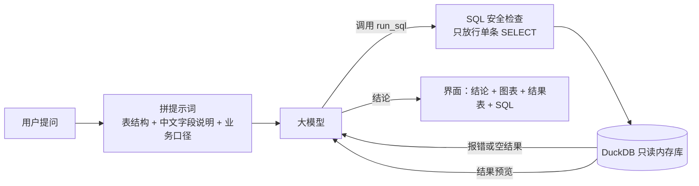

# 智能问数助手

[](https://github.com/timmyknew/timmyknewhere/actions/workflows/tests.yml)

用中文问数据，它自己写 SQL、查数据库、画图，并用一两句话给出结论。查询出错时，它会读报错、自己改 SQL 再试。

> 在线体验：部署后补上链接
> 演示动图：部署后补上

例如问“各州的平均配送天数是多少？哪个州最慢？”，它会：

1. 根据表结构写出 SQL，关联订单、用户、州三张表；
2. 在只读数据库里执行；如果字段写错了，把报错发回给模型，模型改完再执行；
3. 自动选图（这里是横向柱状图），并写出结论：“配送最慢的是罗赖马州，平均 29.3 天……”。

## 功能

- **中文提问，自动出 SQL**：基于大模型的工具调用（function calling），模型调用 `run_sql` 执行查询。
- **报错自动修正**：SQL 报错或结果为空时，把信息反馈给模型修正，最多重试 2 次；界面的“执行过程”里能看到每一次尝试。
- **自动选图**：按结果的形状选择折线图、柱状图、饼图或指标卡。
- **多轮追问**：可以接着问“那按年份拆开呢？”，模型能看到前几轮的问题和 SQL；每个回答下面还会给出两个可以接着问的问题，点一下就能问。
- **结果可下载**：查询结果一键导出 CSV，用 Excel 打开中文不乱码。
- **上传自己的数据**：支持 CSV 和 Excel，自动生成表结构说明。
- **可切换模型**：DeepSeek Flash、DeepSeek V4 Pro、智谱 GLM-4-Flash（免费）。
- **准确率有评测**：113 道带标准答案的中文业务问题，线上配置准确率 98.2%（DeepSeek，单次评测），方法和局限见下方[评测](#评测)。

## 架构



**只读与安全**：公开演示里任何人都能输入问题，所以 SQL 有三层保护：

1. 用 DuckDB 自带的解析器检查，只允许一条 `SELECT`，并拦截读写文件的函数；
2. 数据库建好后关闭文件访问、锁定配置，即使绕过第一层也读不了服务器上的文件；
3. 每条查询 10 秒超时、最多返回 1000 行。

公开演示还限制了用量：每个访客最多问几次、全站每天最多回答多少次，都可以用环境变量调整，防止 API 额度被刷光。

## 本地运行

需要 Python 3.10 以上，以及 DeepSeek 或智谱任意一家的 API key。

```bash
git clone https://github.com/timmyknew/timmyknewhere.git
cd timmyknewhere
python -m venv .venv
source .venv/bin/activate        # Windows: .venv\Scripts\activate
pip install -r requirements-dev.txt   # 网页 + 测试工具
cp .env.example .env             # Windows: copy .env.example .env
# 打开 .env，填上 DEEPSEEK_API_KEY 或 ZHIPUAI_API_KEY
streamlit run app.py
```

浏览器会自动打开 http://localhost:8501 。

Windows 上如果 `activate` 报“禁止运行脚本”，可以跳过这一步，改用 `.venv\Scripts\python -m pip install -r requirements-dev.txt` 和 `.venv\Scripts\python -m streamlit run app.py`。

运行测试（不需要 API key，用的是脚本化的假模型；也包括用 Streamlit 自带的 AppTest 把整个网页跑一遍）：

```bash
pytest
```

每次推送到 GitHub，测试会在 GitHub Actions 上自动跑一遍（上面的徽章）。

## 在线部署

部署到魔搭创空间（国内能直接打开、免费）的步骤见 [docs/deploy.md](docs/deploy.md)。准备好账号后，一条命令同步代码：

```bash
python scripts/publish_modelscope.py ../askdata-studio
```

## 项目结构

```
app.py                  Streamlit 界面
askdata/
  agent.py              问数 Agent：生成 SQL → 执行 → 反馈修正 → 写结论
  llm.py                大模型调用（OpenAI 兼容接口）
  config.py             可选模型
  quota.py              公开演示的每日用量上限
  db.py                 只读 DuckDB、查询超时、表结构说明
  sql_guard.py          SQL 安全检查
  charts.py             自动选图
  datasets.py           内置数据的中文字段说明和业务口径
data/olist/             处理好的电商数据（parquet）
evaluation/             准确率评测：题库、结果比对、批量运行、报告
scripts/
  build_olist.py        下载并清洗原始数据
  publish_modelscope.py 同步到魔搭创空间
deploy/Dockerfile       备用的 Docker 部署方式
docs/deploy.md          部署步骤
tests/                  自动化测试
```

## 评测

题库有 115 道带标准答案的中文问题（简单 33、中等 56、困难 26；其中 2 道问的是数据里没有的信息，应该拒答），覆盖销量趋势、类目排行、配送时效、评分、复购、支付方式等常见分析。

判分看**查询结果**而不是 SQL 写法：把模型的结果和标准 SQL 的结果比对，列名、列顺序、小数位、百分数写法不同都算对，数字不一致就算错。问“哪个最多”时模型按排行多给了几名，只要排在最前面的对就算对；口径本身有两种合理理解的题（比如只算有效订单），两种都认。规则和例子见 [evaluation/compare.py](evaluation/compare.py)。

同一批题目跑三种配置，看每一步带来多少提升：

| 配置 | 说明 |
|---|---|
| baseline | 只给表名和列名，SQL 出错不重试 |
| schema | 加上中文字段说明和业务口径（GMV 怎么算、按哪个字段数用户等） |
| full | 再加报错自动修正，也就是线上用的配置 |

```bash
python -m evaluation.run --models oracle                      # 不花钱：用标准答案检查评测流程本身
python -m evaluation.run --models deepseek-flash glm-4-flash  # 正式评测，结果在 results/<日期>/report.md（不提交）
```

### 结果（DeepSeek，2026-11-09）

| 配置 | 准确率 | 95% 置信区间 |
|---|---:|---|
| baseline | 86.7%（98/113） | 79.2% – 91.8% |
| schema | 97.3%（110/113） | 92.5% – 99.1% |
| full（线上配置） | **98.2%（111/113）** | 93.8% – 99.5% |

- **中文字段说明和业务口径最有用**：准确率提升 10.6 个百分点，McNemar 检验 p = 0.004。没有口径时，模型常把含运费的支付金额当成销售额、忘了排除取消订单、返回葡萄牙语类目名。
- **报错自动修正这次没有起作用**：345 次运行里 SQL 一次都没报错，schema 和 full 的差别是模型输出的随机波动（p = 1）。要测出它的效果，需要换一个更弱的模型。
- 2 道拒答题都如实说明了数据里没有；平均每题调用模型 2 次、约 6,500 tokens、2.7 秒。
- 剩下的 2 道错题（h02、r02），模型的文字结论是对的，但 SQL 结果里没有直接给出最终值。

完整报告见 [evaluation/reports/2026-11-09-deepseek-flash/report.md](evaluation/reports/2026-11-09-deepseek-flash/report.md)。

**这个数字怎么来的，以及它的局限**：第一次跑分报告的是 71.7%。逐题检查 32 道“错题”后发现，只有 1 道是模型真答错，其余主要是判分太严（比如问“哪个最多”，模型给了前 10 名、第一名就是答案）和标准答案只认一种口径。修正判分、补充合理口径、调整提示词后重跑了两轮，得到上面的结果。因为提示词是对着这套题调的，这个数字会偏乐观；而且是单次评测，同样的配置重跑，每种配置都会有 1 到 3 道题对错翻转。

## 数据

内置数据是 [Olist 巴西电商公开数据集](https://www.kaggle.com/datasets/olistbr/brazilian-ecommerce)（2016–2018，约 10 万订单，CC BY-NC-SA 4.0），处理方式见 [data/README.md](data/README.md)。
